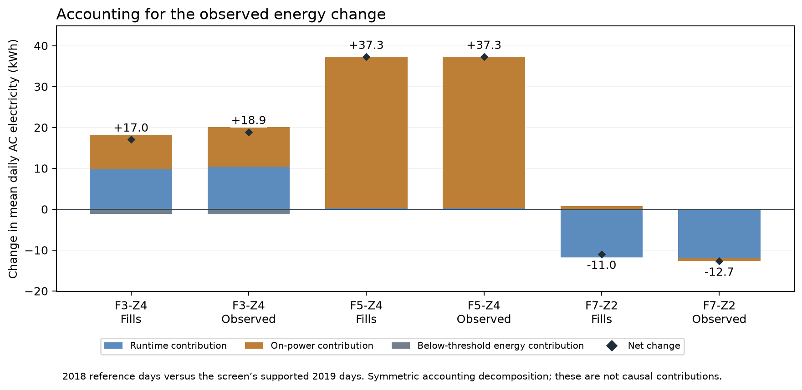
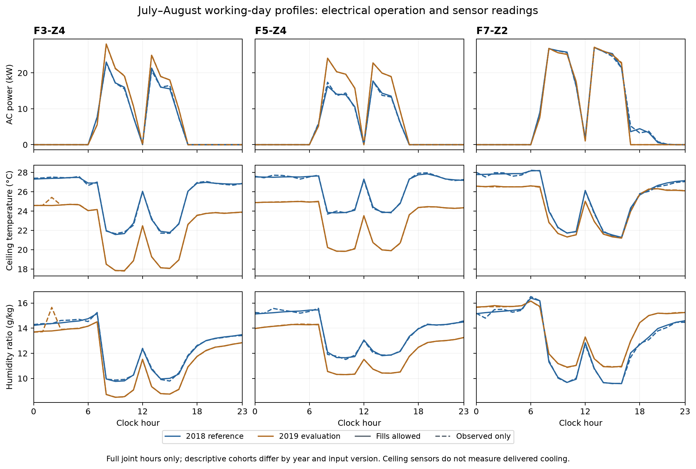

# Track B: AC operating changes and inspection priorities

The Track B analysis identified changes in AC electricity use and recorded indoor conditions that warrant closer inspection. The strongest findings concern **more continuous operation in F3-Z4, higher power during operation in F5-Z4, and higher recorded moisture during sustained AC operation in F7-Z2**. The available evidence does not confirm mechanical degradation, declining cooling efficiency or reduced coil moisture removal.

The findings support an inspection shortlist, with measurement quality and operating conditions checked before assigning a mechanical cause.

## Scope and analytical approach

The analysis covered 20 BQ2 zones across Floors 3–7, using July–August 2018 as the reference period and July–August 2019 for evaluation. Comparing the same calendar months reduces seasonal differences, although it does not establish performance across other seasons.

Two input versions were compared:

- **With fills:** existing cleaned readings, including upstream short-gap interpolation.
- **Without fills:** present source readings that remained unchanged by cleaning.

Daily AC electricity was calculated only for complete 1,440-minute AC-plus-plug days. Reference models used 2018 weather and plug-load activity data, with time-separated validation against simpler benchmarks. Reported comparisons were restricted to 2019 conditions represented in the reference data.

Cooling-response and moisture comparisons required continuous AC operation and adequate environmental coverage. The focused investigations added schedule checks, energy decomposition, matched operating-state comparisons and sensor-error sensitivity tests.

## Screening results

| Zone and indicator | With fills | Without fills | Interpretation |
|---|---:|---:|---|
| **F3-Z4: daily AC electricity** | +13.3%; 22 supported days | +15.2%; 10 days | Strongest energy-model lead; reference validation improved on the simple benchmark |
| **F5-Z4: daily AC electricity** | +36.7%; 23 days | +36.7%; 23 days | Large departure, but the weather reference performed worse than a simple mean |
| **F7-Z2: indoor humidity ratio** | +1.15 g/kg; 33 days | +1.14 g/kg; 29 days | Recorded moisture increase; observed-only reference validation was slightly weaker than the simple benchmark |

These are screening estimates relative to each zone’s reference. The later diagnostic comparisons use separate, explicitly defined cohorts.

Data quality also affected the shortlist. F4-Z1 and F7-Z1 contained near-all-zero AC channels requiring configuration checks, while F5-Z1’s unusually cold environmental readings required sensor verification. F5-Z2 and F6-Z4 showed provisional energy increases with fills allowed, but lacked complete observed-only 2018 energy reference days.

Eight zones remained inconclusive. F3-Z1 and F3-Z2 showed lower supported energy use, while F4-Z5 and F7-Z5 showed no consistent adverse departure. Neither an unavailable comparison nor an absence of a detected signal establishes healthy equipment.

## F3-Z4 and F5-Z4 have different electrical operating changes

*Figure 1. Decomposition of the unadjusted change in mean daily AC electricity. The comparison uses 2018 reference days and the screen’s supported 2019 days. Contributions reconcile arithmetically; they are not causal effects or components of the weather-model residual.*

**F3-Z4 operated more continuously.** Mean time above the AC-on threshold increased from approximately **6.75 to 7.24–7.27 hours/day**, while average power during operation increased from **19.4 to 20.6–20.8 kW**.

Within common business-hour windows, time below the on threshold fell from approximately **25 minutes/day to 0–1 minute/day**. Median start and stop times changed by only a few minutes. The evidence therefore supports more continuous metered operation within the usual schedule. It does not establish whether this resulted from controls, cooling demand, equipment behaviour or another operating change.

**F5-Z4’s increase was concentrated in power level.** Runtime remained close to **7.45 hours/day**, while power during operation increased from approximately **15.1 to 20.1 kW**. Higher on-power accounted for about **99% of the unadjusted energy difference**.

The observed comparison-cohort increase was **33.0%**. This differs from the **36.7% weather-reference estimate**, whose model performed worse than the simple benchmark. The evidence supports a substantial change in electrical loading, but cannot distinguish control settings, equipment/load changes, metering changes or efficiency loss.

## Temperature and moisture readings require a separate interpretation

*Figure 2. Mean working-day profiles for complete joint hours. Blue represents 2018 and orange represents 2019; solid and dashed lines distinguish fills-allowed and observed-only readings. Cohorts differ between years and input versions.*

F3-Z4 and F5-Z4 recorded cooler temperatures in 2019 during both active and inactive periods. After matching clock hour, regional weather and plug activity, readings remained approximately **2.6–3.0°C lower even after at least 24 hours of near-zero AC power**.

This finding prevents a confident claim that increased AC electricity caused the entire temperature shift. Sensor continuity, local placement, adjacent spaces and other thermal or ambient changes remain possible contributors.

The original dataset paper documents ceiling-mounted sensors and their removal for firmware maintenance between September 2018 and March 2019, between the two comparison periods. It does not establish unchanged field calibration or local placement across those periods. [CU-BEMS dataset paper](https://pmc.ncbi.nlm.nih.gov/articles/PMC7371880/)

Consequently, **actual overcooling remains unverified**, even where recorded temperatures are lower.

## F7-Z2 remains a possible performance or control issue

The focused matched-hour comparison reproduced an approximately **1.15–1.16 g/kg increase in recorded moisture during sustained AC operation**, across 37/31 evaluation days with/without fills. Power during those hours changed little, and the moisture increase appeared in both July and August.

The on-versus-night temperature and moisture associations also changed. F7-Z2 therefore remains relevant for AC and operating-condition investigation, rather than being explained solely by an increase in relative humidity caused by cooler air.

However, the physical interpretation remains uncertain:

- A fixed sensor bias shared by both years barely changes the moisture departure.
- Opposing year-specific temperature/RH errors at the paper’s nominal design values can reduce the absolute departure to approximately zero.
- This is a sensitivity scenario, not evidence that those sensor errors occurred.
- A single uniform additive offset does not explain every observed state association; state-dependent sensor effects, ventilation, moisture loads and controls remain alternatives.

F7-Z2’s usual runtime median remained approximately **7.98 hours/day**. Lower mean runtime partly reflected fewer extended-operation days, rather than a demonstrated shortening of its routine schedule. The observed window does not establish progressive equipment deterioration.

## Recommendations

| Priority | Recommended action | Purpose |
|---|---|---|
| **Measurement continuity** | Check sensor identity, calibration, placement and firmware history for the three cases. | Establish whether environmental readings are comparable across years. |
| **F3-Z4 operation** | Review controls, operating modes and the reduction in low-power periods within business hours. | Explain the more continuous electrical operation. |
| **F5-Z4 loading** | Check control/setpoint, equipment, metering and load-change records. | Explain higher on-power with essentially unchanged runtime. |
| **F7-Z2 moisture** | Review sensor calibration, ventilation, internal moisture loads and AC operation together; obtain maintenance, airflow and condensate evidence where available. | Distinguish measurement or operating changes from reduced AC dehumidification. |
| **Provisional zones** | Resolve meter/sensor flags and improve observed-only reference coverage before promoting further zones into the shortlist. | Avoid treating filling-dependent or unavailable results as confirmed performance changes. |

Subsequent monitoring should retain energy-reference departures, on-time, on-power, sustained-on humidity ratio and data coverage together. Control adjustments should be assessed against verified environmental conditions; the historical increase does not establish an equivalent amount of recoverable energy savings.

## Limitations

- **Restricted period:** findings apply to July–August comparisons and cannot be generalised to other seasons or long-term deterioration.
- **Changing samples:** removing fills changes which days and hours qualify. Agreement between versions is a sensitivity check, not independent replication.
- **Strict completeness rules:** small gaps can eliminate complete observed-only days despite high minute-level coverage.
- **Reference uncertainty:** 2018 is not known to be fault-free. Some models failed to improve on simple benchmarks. Screening intervals are conditional and nominal, without adjustment for examining multiple zones.
- **Unmeasured causes:** occupancy, setpoints, ventilation, cooling output, airflow and AC maintenance/failure outcomes were unavailable. Plug load is only an activity proxy.
- **Measurement limits:** ceiling readings and regional ERA5 weather do not establish occupant-level conditions, exact local weather or verified clock alignment.
- **Diagnostic scope:** no zone qualified for a fair adjusted cooling-rate comparison. Validated CUSUM fault thresholds, controlled peer rankings, COP, remaining useful life and confirmed mechanical faults were not established. Mould assessment and the joint risk matrix require Track A evidence.

## Supporting evidence

Supporting calculations and reporting language are available in the [Track B screening notebook](../../bq2_ac.ipynb) and [focused case investigation](../../bq2_case_investigation.ipynb). The [screening evidence](../../outputs/bq2-zone-screen/) and [case evidence](../../outputs/bq2-case-investigation/) contain the underlying tables and provenance.

This report consolidates the analysis preserved in [commit 58896d3](https://github.com/Panhchaknut11/SBA_BQ2/tree/58896d3d9672374b2c0bb9a27ca647204d515061/mould-ac-degradation). Its two figures are unchanged copies of the case-investigation charts, bundled in `figures/` for portable rendering. Saving this report did not rerun the models or alter earlier evidence. It is a Track B report draft for group review; broader seasonal/peer work, Track A and the joint risk matrix remain separate work.
